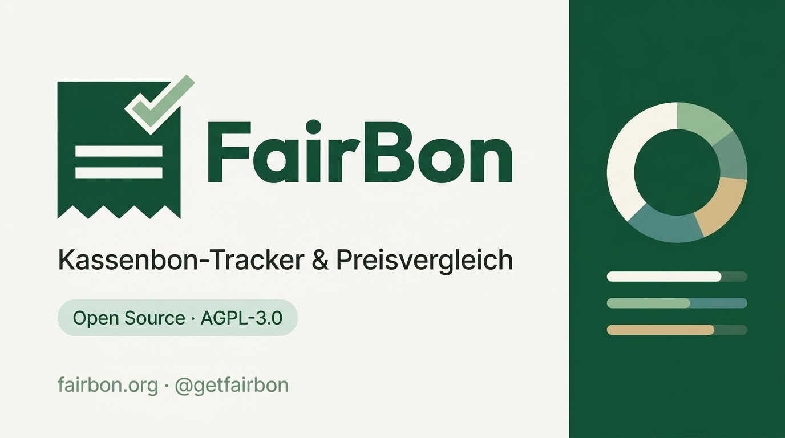

<div align="center">


# 🛒 FairBon

**Open-Source Household Budget & Price Comparison for German Supermarkets**  
*Privacy-first · Local · Community-driven*

[](LICENSE)
[](https://github.com/users/code-shed/projects/1)
[]()



</div>

---

## 🎯 What is FairBon?

FairBon helps you **track purchases, compare prices, and save money** – **without your data ever leaving your device**.

| Feature | Status | Description |
|---------|--------|-------------|
| 🧾 **Receipt Import** (photo / eBon / manual) | ✅ *MVP* | Photo → structured line items (product, quantity, price, promo/regular) |
| 📊 **Price History & Trends** | ✅ *MVP* | How has the price of "Oat milk 1L" evolved over 6 months? |
| 🏷 **Promos vs. Regular Prices** | 💡 *Concept* | Detect: "Is this a real deal or just the normal price?" |
| 🛍 **Smart Basket** | ✅ *MVP* | "I need milk, oats, apples – where is the basket cheapest *today*?" |
| 🔒 **100% local / offline-first** | ✅ *Design Principle* | No cloud, no tracking, no accounts – your data, your rules |
| 🇩🇪 **Focus: DE Supermarkets** | ✅ *Scope* | REWE, EDEKA, Aldi, Lidl, Netto, Penny, Kaufland, dm, Rossmann, … |

> **Why AGPL-3.0?**  
> If someone runs FairBon as a web service and modifies the code, they *must* publish the changes. This guarantees long-term: **Your data stays yours.**

---

## 🚀 Quickstart (Development)

> **Production?** See [`SECURITY_DEPLOYMENT.md`](SECURITY_DEPLOYMENT.md) for
> the hardened Docker setup (127.0.0.1 binding, 512 MB limit, Caddy, Turnstile,
> backups, UFW, fail2ban).

```bash
# 1. Clone
git clone https://github.com/code-shed/fairbon.git
cd fairbon

# 2. Dependencies + Python 3.12 (uv installs it if needed)
uv sync --python 3.12

# 3. Optional: passwords and vision provider
cp .env.example .env
chmod 600 .env
# set SITE_PASSWORD, ADMIN_PASSWORD, SESSION_SECRET and VISION_* keys

# 4. Start
./start.sh
# → http://localhost:8000/
```

Checks:

```bash
uv run pytest -q
uv run ruff check .
```

**Try it without an API key:** open the app and click
*"Nur zum Testen? Beispiel-Bon ausprobieren"* — a static German demo receipt
runs the full review/checklist flow with zero API cost.

**Photo scans** need a vision key (`VISION_PRIMARY_*`, e.g. Gemini, Mistral,
OpenAI-compatible or OpenCode). Without a key, eBon text/PDF/manual entry works
fully offline and free.

**Tech stack:** Python 3.12, FastAPI, Pydantic v2, SQLite (WAL), httpx,
Pillow, pypdf, openpyxl, pytest, ruff, and a modular vanilla-JS PWA
(Capacitor-ready, no build step).

---

## 🔒 Before pushing — secret check

Never commit `.env`, databases, API keys or personal data. Run:

```bash
python3 scripts/check_secrets.py
```

The check compares real values from your local `.env` against all tracked
files and scans staged changes for key/token patterns. It prints findings
without ever showing the secret itself and exits non-zero if anything looks
wrong. The local `pre-push` hook runs it automatically; install it in a fresh
clone with:

```bash
cp scripts/pre-push .git/hooks/pre-push && chmod +x .git/hooks/pre-push
```

---

## 🤝 Contributing – Contributing Guide

We welcome **every kind of contribution**: code, docs, issues, ideas, tests, translations, design.

### 1. Project Board & Work Packages
👉 **Central overview:** [GitHub Project Board "@fairbon"](https://github.com/users/code-shed/projects/1)
There you'll see: Backlog → Ready → In Progress → Review → Done

### 2. Good First Step
- Check **Issues** (labels `good first issue`, `help wanted`)
- Or open a **new Issue** for bug, feature, question
- Comment: "I'll take a look" – we'll assign it to you

### 3. Workflow
```text
main (protected)
  ↑ PR (Review + CI green)
feature/short-description   (your branch)
  ↑ commits (conventional: feat:, fix:, docs:, refactor:, test:, chore:)
```

- **Commits:** Conventional Commits (`feat: add receipt parser`)
- **PR Template** coming soon – for now: briefly describe *What & Why*
- **Tests & Lint** must pass (`uv run pytest -q`, `uv run ruff check .`)

### 4. Code of Conduct
Friendly, constructive, respectful – [Contributor Covenant](https://www.contributor-covenant.org/).

---

## 🗺 Roadmap

| Phase | Goal | Status |
|-------|------|--------|
| **1** | Cleanup, receipt/alias schema, fail-closed security, WAL | ✅ done |
| **2** | Vision scanner (failover/BYOK), upload hardening, 2-sheet Excel export | ✅ done |
| **3** | Modular PWA, 4-tab UI, demo receipt, branding | ✅ done |
| **4** | Hardened Docker deployment, security guide | ✅ done |
| **5** | Real receipt data, moderation workflow, always-on deployment | 🎯 next |
| **6** | Price trends over real data, monthly reports, alerts | planned |

---

## 📂 Project Structure

```text
fairbon/
├── supermarket_comparison/
│   ├── api/                 # FastAPI app, routes, security middleware
│   ├── services/            # vision, upload security, aggregator, validator
│   ├── storage/             # SQLite repository, community prices, schema
│   └── normalization/       # units, brands, matching, relevance
├── frontend/                # modular PWA (CSS, JS views, manifest, SW)
├── tests/                   # pytest (unit + integration)
├── scripts/                 # seed_demo.py, QA helpers
├── assets/branding/         # logo + banners (README/social)
├── docs/                    # architecture, migration, design notes
├── Dockerfile               # non-root production image
├── docker-compose.yml       # 127.0.0.1 binding, 512 MB, read-only
├── SECURITY_DEPLOYMENT.md   # production guide (Caddy, UFW, backups)
├── pyproject.toml, uv.lock  # reproducible dependencies
└── start.sh                 # local start
```

## 🎨 Branding

The FairBon logo, banners and app icons live in [`assets/branding/`](assets/branding/)
(repository/README/social preview) and `frontend/assets/branding/` (served by
the PWA). App icons and favicons are generated in `frontend/icons/`.

- **No third-party supermarket logos** are used anywhere.
- Products without a photo show our own SVG category icons.

## 📜 License & Copyright

**AGPL-3.0-or-later** – see [`LICENSE`](LICENSE)  
Copyright © 2024 **code-shed** & Contributors

> Short: **Use, modify, share allowed – but hosted modifications must be open-sourced.**

---

## 💬 Contact & Community

- **Issues & Discussions:** [GitHub Issues](https://github.com/code-shed/fairbon/issues)
- **Project Board:** [https://github.com/users/code-shed/projects/1](https://github.com/users/code-shed/projects/1)
- **Later:** Discord / Matrix / Forum (if demand exists)

---

<div align="center">

**FairBon is built by the community, for the community.**  
⭐ Star the repo if you like the idea – it helps with visibility!

</div>