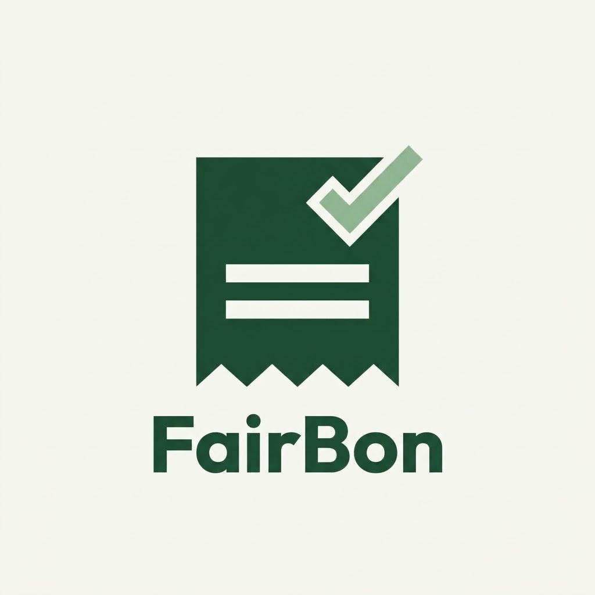

<div align="center">



# 🛒 FairBon

**Open-Source Household Budget & Price Comparison for German Supermarkets**  
*Privacy-first · Local · Community-driven*

[](LICENSE)
[](https://github.com/users/code-shed/projects/1)
[]()


</div>

---

## 🎯 What is FairBon?

FairBon helps you **track purchases, compare prices, and save money** – **without your data ever leaving your device**.

| Feature | Status | Description |
|---------|--------|-------------|
| 🧾 **Receipt Import** (photo / eBon / manual) | ✅ *MVP* | Photo → structured line items (product, quantity, price, promo/regular) |
| 📊 **Price History & Trends** | ✅ *MVP* | How has the price of "Oat milk 1L" evolved over 6 months? |
| 🏷 **Promos vs. Regular Prices** | 💡 *Concept* | Detect: "Is this a real deal or just the normal price?" |
| 🛍 **Smart Basket** | ✅ *MVP* | "I need milk, oats, apples – where is the basket cheapest *today*?" |
| 🔒 **100% local / offline-first** | ✅ *Design Principle* | No cloud, no tracking, no accounts – your data, your rules |
| 🇩🇪 **Focus: DE Supermarkets** | ✅ *Scope* | REWE, EDEKA, Aldi, Lidl, Netto, Penny, Kaufland, dm, Rossmann, … |

> **Why AGPL-3.0?**  
> If someone runs FairBon as a web service and modifies the code, they *must* publish the changes. This guarantees long-term: **Your data stays yours.**

---

## 🚀 Quickstart (Development)

> **Early Alpha** – the receipt tracker, community prices and smart basket
> already run locally. Photo scans need a vision key (or use the demo receipt).

```bash
# 1. Clone repository
git clone https://github.com/code-shed/fairbon.git
cd fairbon

# 2. Python environment (recommended: uv or venv)
python -m venv .venv
source .venv/bin/activate
pip install -U pip
pip install -e ".[dev]"   # once pyproject.toml exists

# 3. Pre-commit hooks (later)
pre-commit install

# 4. Run tests
pytest -q
```

**Planned Tech Stack** (open for discussion – see [Issues](https://github.com/code-shed/fairbon/issues)):
- **Backend:** Python (FastAPI / SQLAlchemy / Pydantic) – local as single binary or Docker
- **Frontend:** Web UI (HTMX + Tailwind or React) + optional Native Desktop (Tauri/Electron)
- **OCR:** Tesseract / PaddleOCR / Apple Vision / Google ML Kit (local)
- **Storage:** SQLite (local), later maybe DuckDB for analytics

---

## 🤝 Contributing – Contributing Guide

We welcome **every kind of contribution**: code, docs, issues, ideas, tests, translations, design.

### 1. Project Board & Work Packages
👉 **Central overview:** [GitHub Project Board "@fairbon"](https://github.com/users/code-shed/projects/1)  
There you'll see: Backlog → Ready → In Progress → Review → Done

### 2. Good First Step
- Check **Issues** (labels `good first issue`, `help wanted`)
- Or open a **new Issue** for bug, feature, question
- Comment: "I'll take a look" – we'll assign it to you

### 3. Workflow
```text
main (protected)
  ↑ PR (Review + CI green)
feature/short-description   (your branch)
  ↑ commits (conventional: feat:, fix:, docs:, refactor:, test:, chore:)
```

- **Commits:** Conventional Commits (`feat: add receipt parser`)
- **PR Template** coming soon – for now: briefly describe *What & Why*
- **Tests & Lint** must pass (CI comes with first code)

### 4. Code of Conduct
Friendly, constructive, respectful – [Contributor Covenant](https://www.contributor-covenant.org/) (will be linked once `CODE_OF_CONDUCT.md` exists).

---

## 🗺 Roadmap (High-Level)

| Phase | Goal | Milestone |
|-------|------|-----------|
| **0** | Repo structure, CI, dev setup, license | ✅ *in progress* |
| **1** | Data model (products, markets, prices, receipts), SQLite schema, basic CRUD | 🎯 *next* |
| **2** | Receipt import (manual + OCR prototype) | |
| **3** | Price history, charts, export (CSV/JSON) | |
| **4** | Smart Basket & cross-market price comparison | |
| **5** | Desktop App (Tauri), Installer, Auto-Update | |
| **6** | Community features: price reports, crowdsourcing (opt-in, anonymous) | |

---

## 📂 Project Structure (Planned)

```text
fairbon/
├── .github/                 # Workflows, Issue/PR templates
├── docs/                    # Architecture, ADRs, API docs
├── fairbon/                 # Python package (Backend)
│   ├── api/                 # FastAPI routers
│   ├── core/                # Config, Security, DB
│   ├── models/              # SQLAlchemy/Pydantic models
│   ├── services/            # Business logic (OCR, Matching, Analytics)
│   └── cli.py               # Typer/Click CLI
├── frontend/                # Web UI (later)
├── tests/                   # pytest (unit + integration)
├── scripts/                 # Dev helpers (db-migrate, seed, etc.)
├── pyproject.toml           # Build, deps, tool config (ruff, mypy, pytest)
├── .gitignore
├── LICENSE                  # AGPL-3.0
└── README.md                # this file
```

---

## 🎨 Branding

The FairBon logo, banners and app icons live in [`assets/branding/`](assets/branding/)
(repository/README/social preview) and `frontend/assets/branding/` (served by
the PWA). App icons and favicons are generated in `frontend/icons/`.

- **No third-party supermarket logos** are used anywhere.
- Products without a photo show our own SVG category icons.

## 📜 License & Copyright

**AGPL-3.0-or-later** – see [`LICENSE`](LICENSE)  
Copyright © 2024 **code-shed** & Contributors

> Short: **Use, modify, share allowed – but hosted modifications must be open-sourced.**

---

## 💬 Contact & Community

- **Issues & Discussions:** [GitHub Issues](https://github.com/code-shed/fairbon/issues)
- **Project Board:** [https://github.com/users/code-shed/projects/1](https://github.com/users/code-shed/projects/1)
- **Later:** Discord / Matrix / Forum (if demand exists)

---

<div align="center">

**FairBon is built by the community, for the community.**  
⭐ Star the repo if you like the idea – it helps with visibility!

</div>